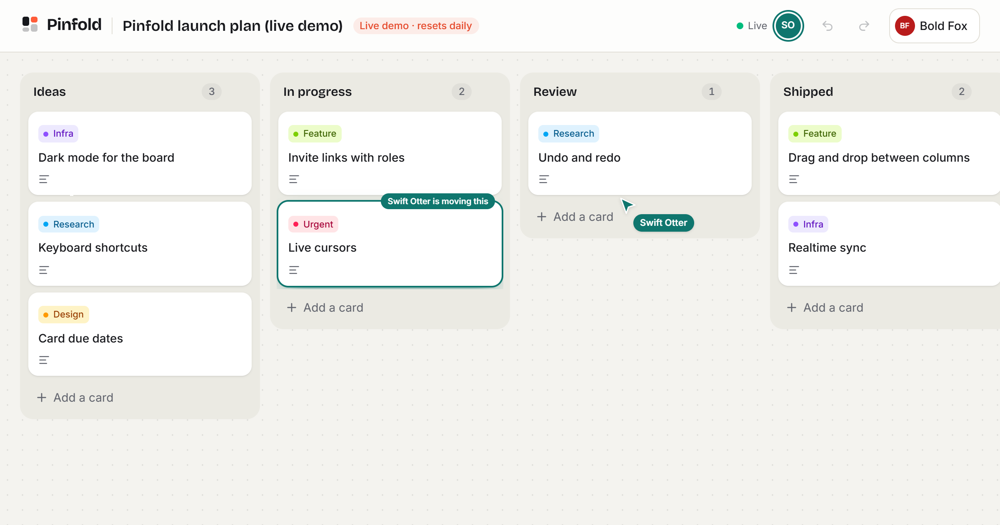
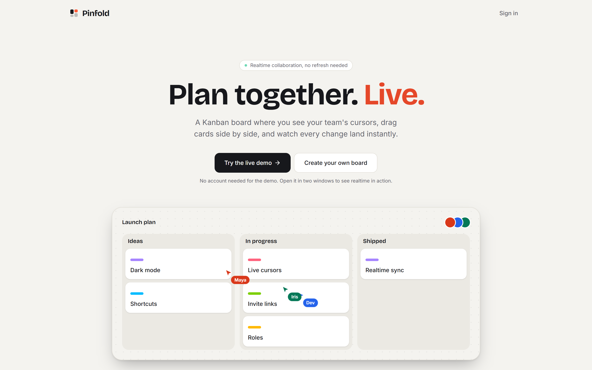
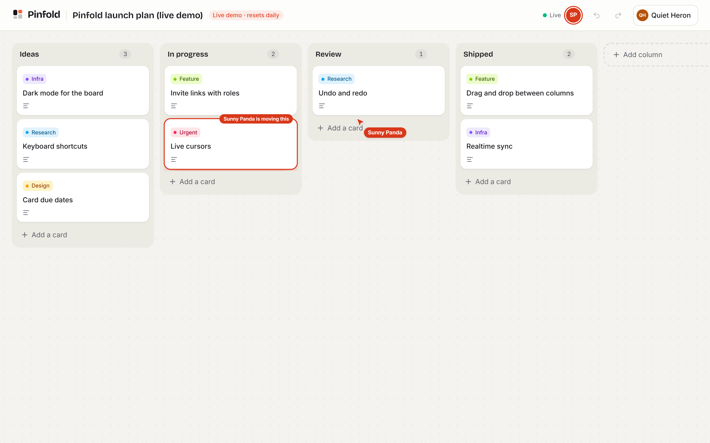
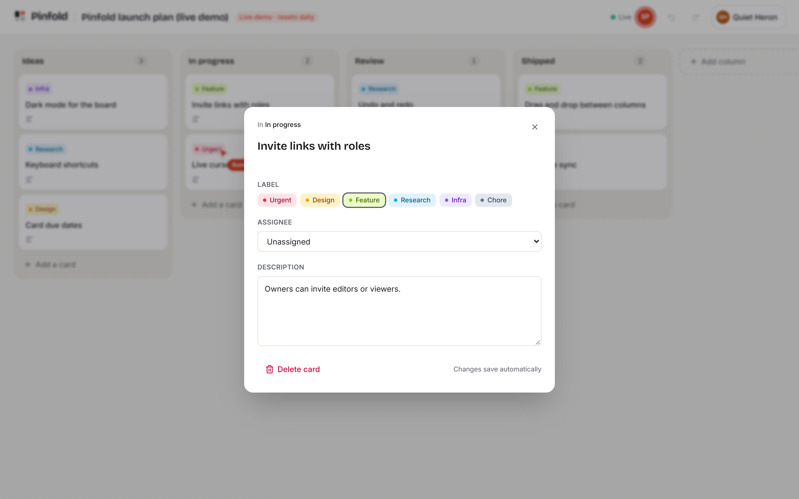
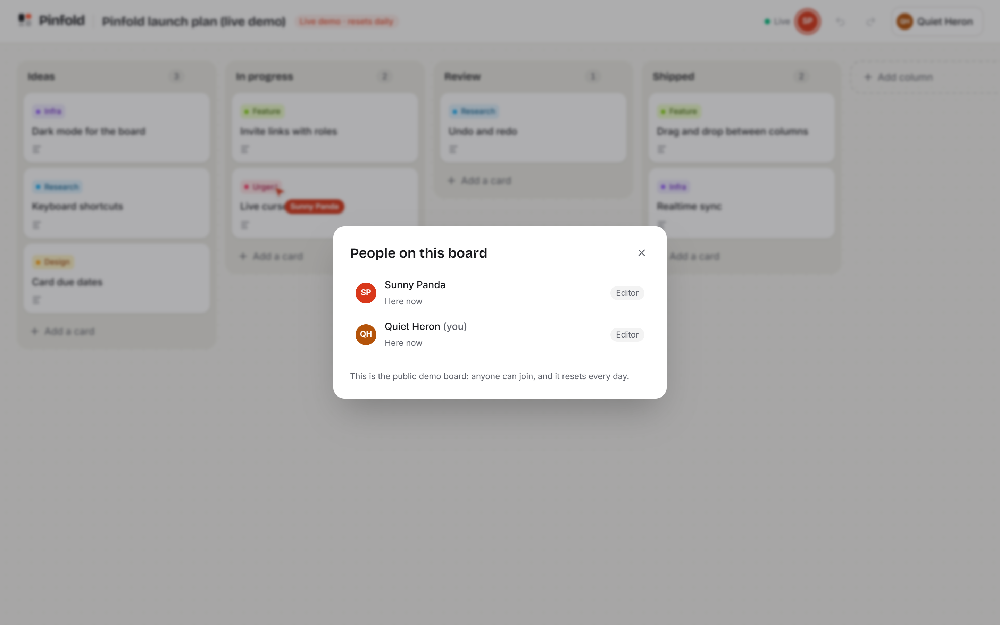
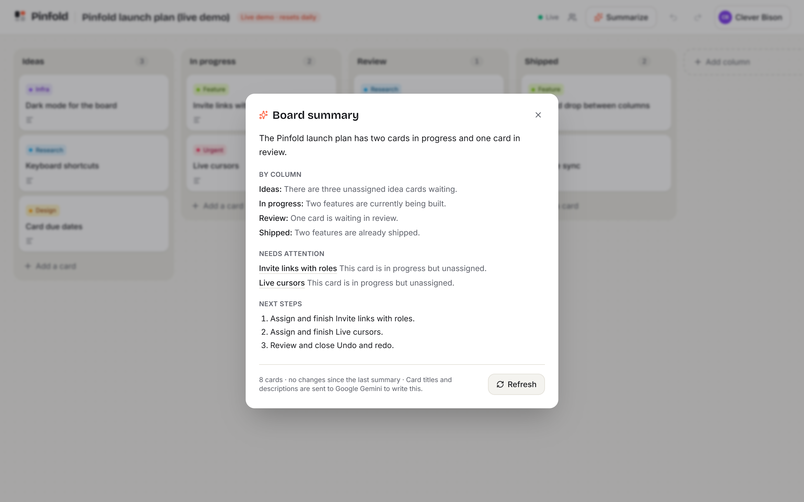
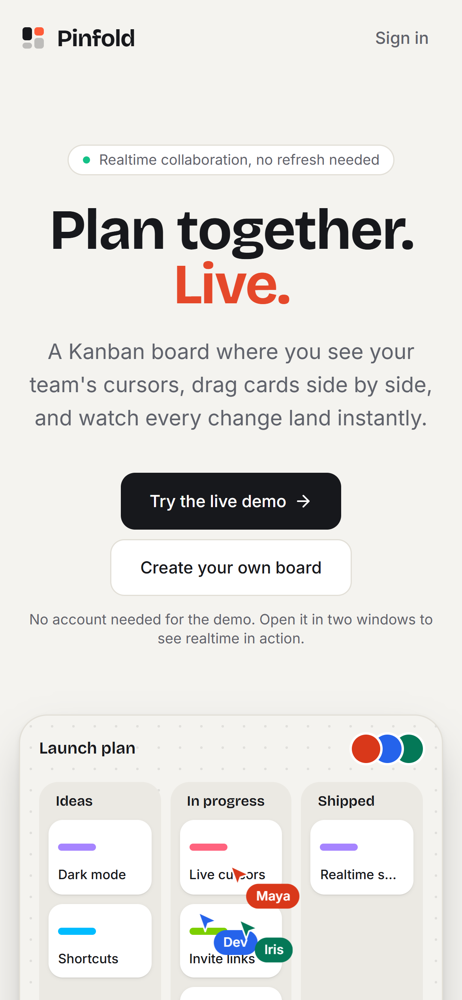
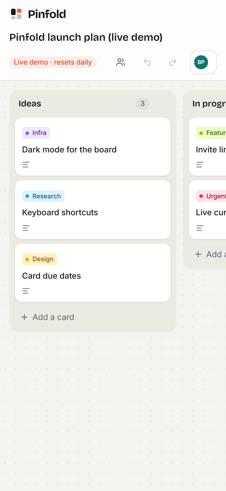
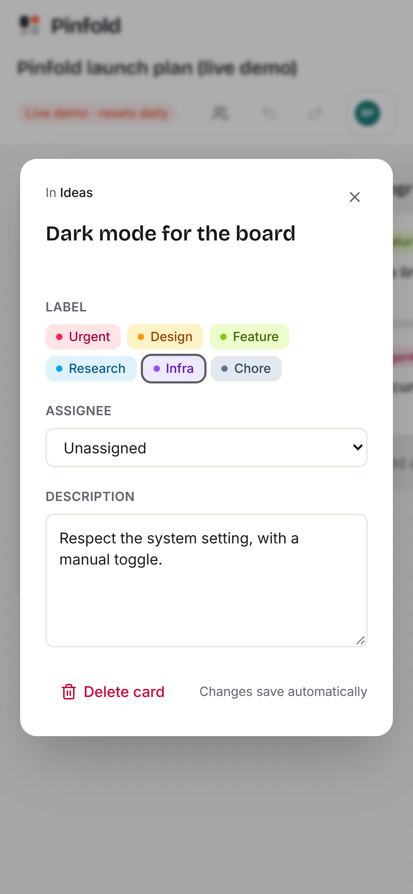

# Pinfold: a realtime collaborative board

**Live site:** https://pinfold-realtime-board.vercel.app · **[Try the live demo](https://pinfold-realtime-board.vercel.app/demo)** (no account needed; open it in two windows)

A Kanban board built for teams working at the same time. You see teammates' cursors move across the board, watch a card light up in their color while they drag it, and every add, edit or move appears for everyone instantly.

> Pinfold is a portfolio project. The public demo board resets every day.



## Screenshots

| Landing | Live collaboration |
|---|---|
|  |  |

| Card details | People on the board | AI summary |
|---|---|---|
|  |  |  |

| Mobile landing | Mobile board | Mobile card |
|---|---|---|
|  |  |  |

More in [`docs/screenshots`](docs/screenshots). The case study is in [`docs/case-study.md`](docs/case-study.md).

## Features
- **Live cursors** with name tags, sent about 25 times a second over Supabase Realtime Broadcast.
- **Presence:** avatars of who's here now, and who's away, with roles.
- **"Maya is moving this":** a card is outlined in the dragger's color on everyone else's screen while they move it.
- **Instant sync** of cards and columns through Postgres change streams. Your own edits are optimistic, so they appear immediately and roll back with a clear message if the save fails.
- **Drag and drop** between columns with mouse, touch or keyboard (dnd-kit), using fractional positions so a move writes one row.
- **AI board summary:**
  - One click writes where the board stands: a headline, one line per column, the cards that need attention (each opens on click) and next steps.
  - Gemini structured output, read as the signed-in member so Row Level Security decides what can be summarized.
  - Reused while the board hasn't changed, rate-limited per person, and the dialog says what's sent to the model.
- **Undo and redo** (Ctrl+Z / Ctrl+Shift+Z) of your own adds, edits, moves and even deleted columns with their cards.
- **Workspaces and roles:** create boards and invite people by link as editors or viewers. Owners manage roles.
- **One-click demo:** guests join a shared board without an email (Supabase anonymous sign-in). A daily Vercel Cron job resets it.
- **Accessible:** real buttons, native `<dialog>` modals, keyboard dragging, and color choices that keep white name tags at WCAG AA contrast.

## How the realtime works

```
                ┌──── Postgres changes (cards, columns, members) ───┐
 browser A ──▶  │   RLS decides which rows each subscriber receives │  ──▶ browser B
   writes rows  └───────────────────────────────────────────────────┘
                ┌──── private channel "board:<id>" ─────────────────┐
 browser A ──▶  │   presence + cursor + "dragging" broadcasts       │  ──▶ browser B
                │   realtime.messages RLS: board members only       │
                └───────────────────────────────────────────────────┘
```

- **Durable state:** cards, columns and members are written straight to Postgres from the browser. Row-level security enforces who may do what, and other clients receive the changes through Realtime.
- **Ephemeral state:** cursors, presence and drags never touch the database. They travel on a **private** channel whose access is checked against board membership.
- **While dragging:** remote updates to the card you're holding are deferred until you drop it, so it can't jump out of your hand. After a reconnect, the board re-fetches so nothing is missed.

## Security (tested)
All access control lives in the database ([`supabase/schema.sql`](supabase/schema.sql)):
- **Role checks:** helper functions (`is_member`, `can_edit`, `is_owner`) back every table policy.
- **Vetted actions:** boards, invites and the demo can only be created through `SECURITY DEFINER` functions with their own checks. Guests can't create boards or accept invites.
- **Private channels:** cursors and presence are restricted to board members.
- **Demo limits:** caps on cards and columns, and only the server can reset it.

`npm run check:security` runs **24 attack-style checks** against a real Supabase project with temporary users: a stranger reading, editing, joining or eavesdropping, a viewer editing or promoting themselves, fake invites, and admin-only functions. All 24 pass. `npm run check:guests` adds **7 guest checks**, also all passing.

## Testing
- **Security:** the 24 security and 7 guest checks above.
- **Two-browser realtime test** (two separate guests, headless Chrome), **11 of 11 passing:**
  - presence both ways, and live cursors
  - an added card appearing in the other browser (~0.85 s)
  - the "moving this" indicator, and drags landing for the other user
  - delete, undo and redo syncing across browsers, and leave detection
- **Mobile:** no horizontal page scroll, and columns scroll sideways.

## Lighthouse (production build, landing page)
| | Performance | Accessibility | Best Practices | SEO |
|---|---|---|---|---|
| Desktop | 100 | 100 | 100 | 100 |
| Mobile | 96 | 100 | 100 | 100 |

## Stack ($0)
Next.js 16 (App Router, Proxy) · TypeScript · Tailwind CSS v4 · Supabase (Postgres, Auth with magic links + anonymous sign-in, Realtime) · dnd-kit · AI SDK + Gemini (board summary, free tier) · Vercel Hobby (+ Cron)

## Run locally
```bash
npm install
cp .env.example .env.local   # Supabase URL, publishable key, secret key, CRON_SECRET, GOOGLE_GENERATIVE_AI_API_KEY (optional, for summaries)
npm run dev
```

1. **Set up the database:** run [`supabase/schema.sql`](supabase/schema.sql) in the Supabase SQL editor. It creates the tables, policies and realtime setup, and seeds the demo.
2. **Enable guest access:** in Supabase **Authentication → Sign In / Providers**, enable **anonymous sign-ins**.
3. **Allow sign-in redirects:** add `http://localhost:3000/**` and your deployed URL to the Auth redirect URLs.

## Project structure
```
src/
  app/
    b/[id]/                 # the board
    demo/                   # one-click guest demo
    boards/ invite/ login/  # boards list, invite acceptance, magic-link sign-in
    api/cron/reset-demo/    # daily demo reset (Vercel Cron, secret-protected)
  hooks/
    use-board.ts            # data, Postgres change streams, optimistic writes, undo/redo
    use-presence.ts         # private channel: presence, cursors, drag indicators
  components/board/         # board, columns, cards, cursors, dialogs
  lib/                      # positions (fractional ordering), types, Supabase clients
  proxy.ts                  # keeps the session fresh
scripts/                    # security-check, guest-check, cleanup-guests
supabase/schema.sql
docs/                       # thumbnail, screenshots, case study
```

## What I learned
- **Split durable and ephemeral state.** Cards belong in the database. Cursors and "who's dragging" don't; sending them as broadcasts keeps them fast and keeps the database quiet.
- **With direct database access, RLS is the security model.** I wrote policies around small role helpers and proved them with an automated attack script rather than trusting them.
- **Optimistic UI needs a rollback story.** Every write applies locally first and records its own inverse, which gave both error recovery and undo/redo almost for free.
- **Realtime has edge cases.** Remote updates to a card you're dragging have to wait, and delete events can't be filtered, so unknown ids have to be ignored safely.
- **Accessibility applies to fun details too.** Bright cursor colors failed contrast with white name tags, so I picked deeper shades that still read as distinct.

_Edit these in your own words before sharing._
