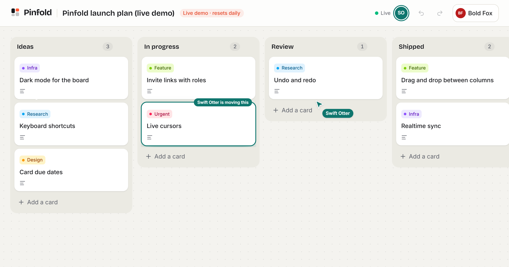
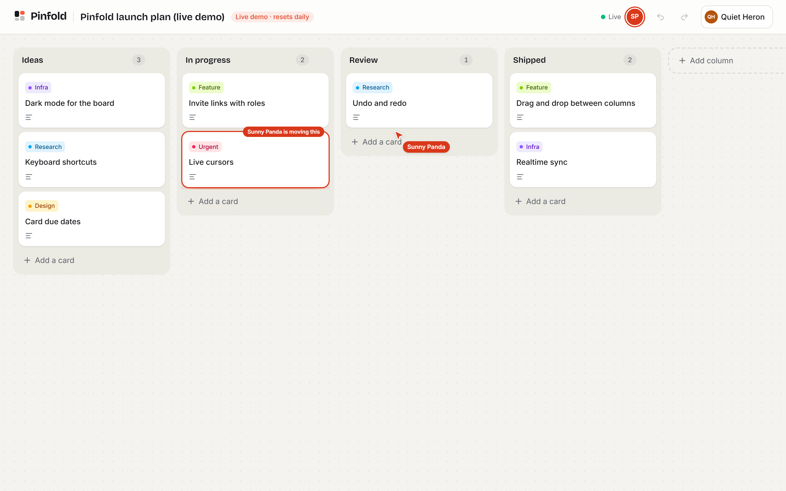
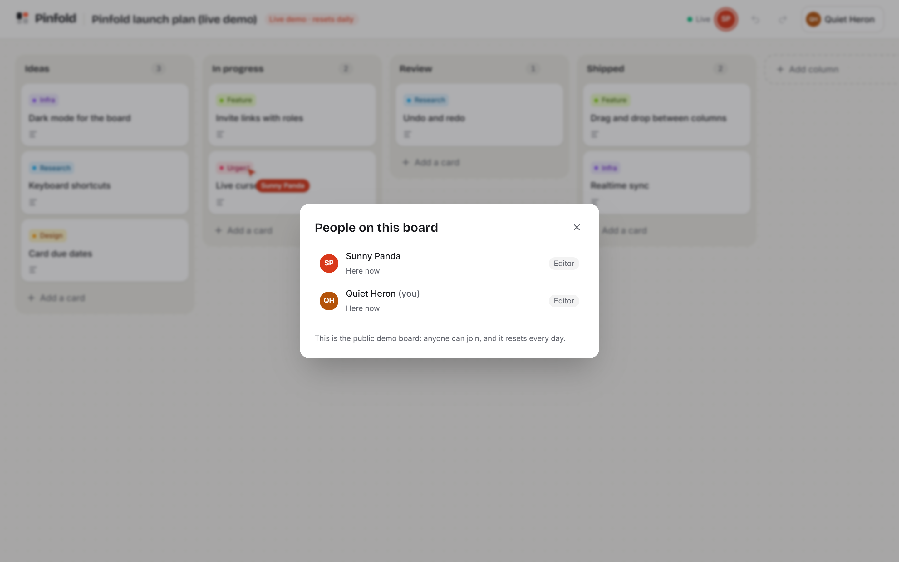
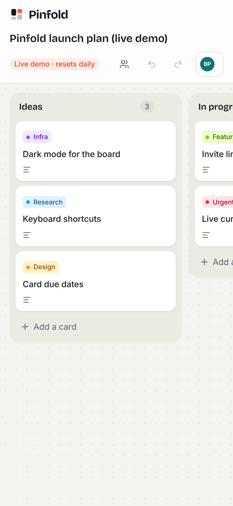
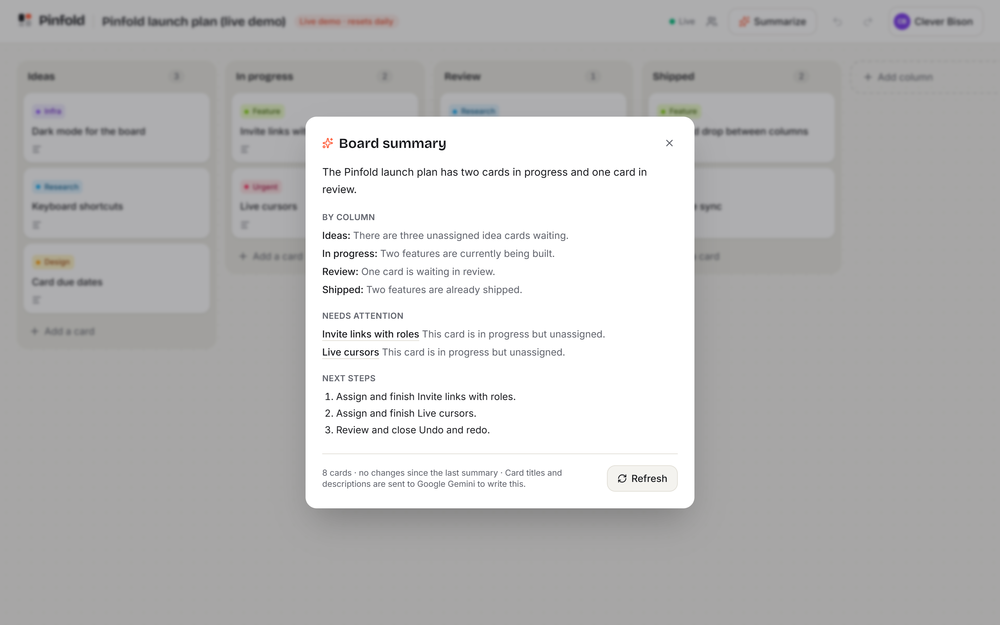

# Pinfold: case study

**Role:** Design and development (solo)
**Type:** Realtime collaborative web app
**Stack:** Next.js 16, TypeScript, Tailwind CSS v4, Supabase (Postgres, Auth, Realtime), dnd-kit, Vercel
**Links:** [Live site](https://pinfold-realtime-board.vercel.app) · [Live demo](https://pinfold-realtime-board.vercel.app/demo) · [Code](https://github.com/shervs336/pinfold-realtime-board)

---

## Short version (for a portfolio card)

> A realtime Kanban board: live cursors, presence, drag-and-drop that shows who's moving what, instant sync, undo/redo, and invites with roles. Security is enforced in the database and proven by an automated 24-check attack script. You can try it without an account.

---

## Problem

Most task boards are "realtime" only in the sense that they refresh. Teams working together still talk over each other: two people move the same card, edits collide, and nobody can tell who is looking at what.

The goal was a board that feels shared, where you can see your teammates working, while staying secure even though the browser talks to the database directly.

## Approach

- **Two kinds of realtime.**
  - **Durable data:** cards, columns and members sync through Postgres change streams, filtered per user by row-level security.
  - **Ephemeral signals:** cursors, presence and "who's dragging" travel as broadcasts on a private channel, so they're fast and never hit the database.
- **Optimistic everything.** Every edit shows instantly and records its inverse. The inverse is used to roll back failed saves and also powers undo/redo.
- **One-click demo.** Anonymous sign-in lets reviewers join a shared board instantly. A daily cron job resets it.

## Key decisions

| Decision | Why |
|---|---|
| Browser writes directly to Postgres, guarded by RLS | Lowest latency for a realtime app; the database is the single source of truth for permissions. |
| Role helper functions (`is_member`, `can_edit`, `is_owner`) | Keeps every policy short and readable, and avoids recursive policy checks. |
| Boards, invites and demo joins only through vetted functions | Clients can't insert memberships directly, so nobody can make themselves a member or owner. |
| Private Realtime channel per board | Strangers are refused the channel, so they can't see who's online or where cursors are. |
| Fractional positions | Moving a card writes one row instead of renumbering a column, so concurrent moves rarely conflict. |
| Defer remote updates to the card you're dragging | Prevents a teammate's edit from yanking the card out of your hand mid-drag. |
| Guests can't create boards; demo has caps | Keeps the public demo from becoming a spam vector. |

## Testing

- **Security script, 24/24 passing:** creates temporary owner, viewer and stranger accounts on the real project, then tries to:
  - read, edit or join a stranger's board
  - escalate a viewer's role
  - reuse fake invite tokens
  - eavesdrop on the private channel
  - call admin-only functions

  It deletes everything afterwards.
- **Guest checks, 7/7 passing:** guests can join the demo but can't create boards, accept invites, or rename or delete the demo.
- **Two-browser realtime test, 11/11 passing:** two separate guests in headless Chrome verify presence, live cursors, card sync (~0.85 s), the "moving this" indicator, drag results, and delete, undo and redo across browsers.

## Result

- Live, public, and free to run (Supabase free tier + Vercel Hobby).
- **Lighthouse (landing):** Desktop 100 / 100 / 100 / 100. Mobile 96 / 100 / 100 / 100.

| People and roles | Mobile |
|---|---|
|  |  |

## What I'd do next

- Column reordering by drag.
- An activity feed ("Maya moved *Live cursors* to Review").

## Added later: AI board summary

A **Summarize** button asks Gemini for a structured summary of the board: a headline, one line per column, the cards that need attention and next steps. The data is read as the signed-in member, so the same Row Level Security rules apply. A summary is reused until a card changes, and each person can ask for six every ten minutes (per server instance), which keeps it inside the free tier. The dialog says that card text is sent to Google.

